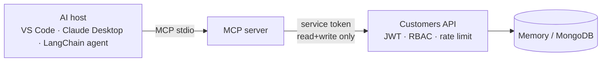

# CRM Copilot MCP

> Connect AI to a legacy system **without rewriting it, and without giving up security.**

An [MCP](https://modelcontextprotocol.io) server that exposes a customer-management API to any AI host (VS Code, Claude Desktop, a LangChain.js agent) with enterprise-style safeguards: **JWT + RBAC, scoped service tokens, per-identity rate limiting**, and least-privilege tool design.

  

## Why this exists

Most "AI + tools" demos wire a function straight into one chatbot. In real companies the system already exists, many clients need it, and **the model cannot be trusted as the security boundary**. This project shows the full path: legacy API → secure MCP server → multiple AI clients.



More in [docs/architecture.md](docs/architecture.md) (sequence diagram, design decisions, threat model).

## What's inside

| Folder | What | 
|---|---|
| `api/` | Express "legacy" API: JWT login, RBAC, service tokens, rate limiter, Zod validation, memory or MongoDB storage |
| `mcp-server/` | MCP server: **5 tools**, **2 resources**, **2 prompts** |
| `agent/` | LangChain.js agent that discovers tools through `@langchain/mcp-adapters` |
| `tests/` | 11 automated tests, including end-to-end via a real MCP Client over stdio |

### MCP surface

| Type | Name | Notes |
|---|---|---|
| Tool | `list_customers`, `get_customer` | read-only |
| Tool | `create_customer`, `update_customer` | write |
| Tool | `delete_customer` | `destructiveHint`, **refused with the MCP token** (needs admin scope) |
| Resource | `customers://schema` | fields, constraints, scopes |
| Resource | `customers://stats` | live counts by status |
| Prompt | `portfolio_summary`, `onboard_customer` | reusable workflows (the latter checks duplicates first) |

## Quick start (3 commands, no database needed)

```bash
npm install
cp .env.example .env        # Windows CMD: copy .env.example .env
npm run api                 # terminal 1: API on :3000 (in-memory, seeded)
```

Then in a second terminal:

```bash
npm run inspect             # MCP Inspector: browse tools/resources/prompts
npm test                    # 11 tests
npm run agent               # natural-language agent (needs ANTHROPIC_API_KEY in .env)
```

Example agent session:

```
you> cadastre a Marina da Initech (marina@initech.com) como lead
you> marque a Marina como ativa
you> apague a Marina
agent> A API recusou: falta o escopo "customers:delete". Peça a um admin.
```

To use MongoDB instead, set `MONGODB_URI` in `.env`.

## Use it in your editor

**VS Code** (Copilot agent mode): `.vscode/mcp.json` is already included. Start the API, then open the MCP tools picker.

**Claude Desktop** (`claude_desktop_config.json`):

```json
{
  "mcpServers": {
    "crm-copilot": {
      "command": "node",
      "args": ["C:/path/to/crm-copilot-mcp/mcp-server/src/index.js"],
      "env": { "API_URL": "http://localhost:3000", "MCP_SERVICE_TOKEN": "dev-mcp-token" }
    }
  }
}
```

## Security model

| Identity | How it authenticates | Scopes |
|---|---|---|
| `admin` user | `POST /auth/login` → JWT | read, write, delete |
| `viewer` user | JWT | read |
| `mcp-server` service | service token | read, write |
| `admin-service` | service token | read, write, delete |

- The MCP server **never forwards tokens it receives**; it uses its own identity (no token passthrough).
- Per-identity rate limit (default 60/min) plus a stricter per-IP limit on login. `429` includes `Retry-After`, which is surfaced to the model.
- Passwords hashed with scrypt, service tokens kept as SHA-256 digests with constant-time comparison.
- Follows the MCP [Security Best Practices](https://modelcontextprotocol.io/docs/tutorials/security/security_best_practices).

> **Before real use:** the default tokens and passwords in `.env.example` are for local demo only. Change every secret.

## Scripts

| Command | Purpose |
|---|---|
| `npm run api` | start the Customers API |
| `npm run mcp` | start the MCP server on stdio (used by hosts) |
| `npm run inspect` | open MCP Inspector against the server |
| `npm run agent` | LangChain.js agent (REPL, or `npm run agent -- "your request"`) |
| `npm test` | API + MCP end-to-end tests |

## Roadmap
- [ ] Streamable HTTP transport + OAuth 2.1 for remote use
- [ ] Redis-backed rate limiter
- [ ] Publish to npm (`bin` is already configured: `npx crm-copilot-mcp`)
- [ ] Audit log of tool calls

## Built while studying
Pós-graduação em Engenharia de IA Aplicada (UniPDS), disciplina *Model Context Protocol*.

## License
MIT
