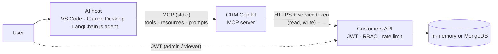
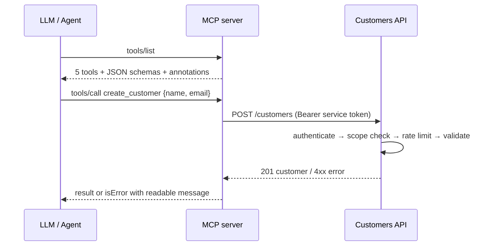

# Architecture

## Request lifecycle

## Design decisions

| Decision | Why |
|---|---|
| The MCP server uses **its own service token**, never a token received from the model or user | Avoids the *token passthrough* anti-pattern from the MCP security best practices |
| MCP token has **read + write only**; `delete` needs the admin token | Least privilege: a prompt-injected agent cannot destroy data |
| `delete_customer` carries `destructiveHint: true` and a "confirm first" description | Lets hosts show confirmation UI and guides the model |
| Rate limit **per identity** (not just per IP) | One runaway agent loop cannot starve other clients |
| API errors are mapped to `isError` tool results | The model can read the error and self-correct (e.g. fix a duplicate email) |
| Zod validation on both MCP input and API input | Defense in depth; the API stays safe even if called without MCP |
| Service tokens stored as SHA-256 digests, compared in constant time | No plaintext secrets in memory dumps, no timing leaks |
| Storage behind a repository interface (memory / MongoDB) | Demo runs with zero setup; production swap is one env var |
| stdio server logs to **stderr** only | stdout is the protocol channel |

## Threat model (summary)

| Threat | Mitigation |
|---|---|
| Prompt injection makes the agent delete data | Delete scope not granted to the MCP token; destructive annotation |
| Token passthrough / confused deputy | Dedicated service identity per server |
| Excessive permissions | Scopes per token and per role |
| Abuse / runaway loops | Per-identity rate limiting, `Retry-After` surfaced to the model |
| Credential stuffing on login | Separate, stricter per-IP login limiter + scrypt hashing |
| Malformed input | Schema validation, 50 KB body limit |

## Known limitations / next steps
- Rate limiter is in-memory (single instance). Use Redis for multi-instance.
- Tokens come from env vars. Use a secrets manager and rotation in production.
- Add Streamable HTTP transport with OAuth 2.1 for remote MCP use.
